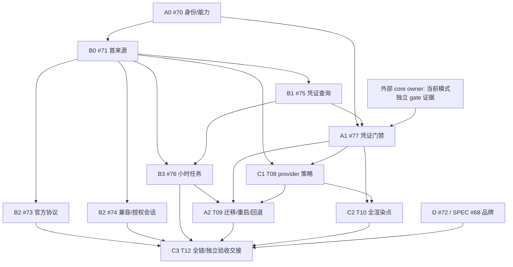

# #66 四包精确工作交接

**LOCAL ONLY / Kanban 提案，未建板、未加卡、未启动实施。** 唯一 writer 仍为 `bdb38eb8-7a2b-40fe-881b-c5925885bd0a`。Hermes 负责建四张 SPEC 卡、独立验收及后续授权集成；不得因阶段切换再开 writer／worktree。用户说明 resume 副本 `2377cdb3` 已停止，本会话未操作该副本。

公共正文待审清单和指纹见[安全 payload 审查](./hermes-payload-review.zh-CN.md)。仅 D 已有 canonical 子 SPEC #68，A/B/C 是公共候选，不能把本地文件或本提案冒称已登记 GitHub SPEC。原父 [#66](https://github.com/williamxhero/CPA-Manager-Plus-ex/issues/66) 保留全部需求与验收。

## 1. 统一 owner、工作区与状态

- CPAMP workspace：`D:/WILL/AGENT/CPA/cpamp-issue66-plan`；repo：`williamxhero/CPA-Manager-Plus-ex`；feature branch：`claude/issue66-plan`；HEAD：`88ef979b`。当前 Git 只读，本轮候选／交接未提交。
- 单一来源 writer 负责 A/B/C/D 规划与后续获授权的 CPAMP 工作；四卡不是四 writer。core 改动只交目标项目 owner，通过 cross-project-delegation，目标项目自己的权限、规范和验收保持。
- 当前共同状态：`PLANNING_REVIEW`。A/B/C 的 canonical 登记阻塞于 Hermes payload 审查和实际外部写权限；D 复用 #68，不重复建 issue。四卡“准备就绪”不构成本轮实施／部署授权。
- Hermes 可按以下模板建卡，注明各自真实 SPEC 链接／workspace／inputs／deliverable／acceptance／dependencies；未发布的 SPEC 标 `SPEC_REVIEW_BLOCKED`，不要编造 issue 号。若 board 对外可见，只使用获审公共正文与真实公共链接，不附本地调查、此交接或工作区路径等内部材料。

## 2. 四张卡的边界

### 卡 A — 独立门禁消费、协调与安全迁移

- **SPEC**：[待审 66-A](./public-review/66-a-consumer-contract.md)，获审登记后填真实 URL；父 #66。
- **Owner**：同一 CPAMP writer；外部 core 实现 owner 由 Hermes 在目标项目另行指定，不从 CPAMP 直接改其代码。
- **Inputs**：父 #66 的身份／独立门禁／兼容迁移要求；A 公共消费契约；B 的身份绑定及可信凭证查询；C 的 provider 策略结果；目标 owner 回传的实际 capability／固定 revision／路由与启动恢复证据。
- **主要票与里程碑**：A0=#70 身份与能力读取；A1=#77 凭证独立门禁；A2=T09（待发布）历史迁移／重启／回退。每票只有本卡为 primary owner，C 只消费其结果，不再建重复凭证 gate 票。
- **Deliverable**：CPAMP 能如实读取能力、按稳定目标请求独立暂停／恢复并确认真实应用；失败可协调。历史人工意图不被误清，升级／重启／回退不意外放行。
- **Dependencies**：A0 无 ticket blocker，可先做读取／不可用展示。A1 等 #70、#75 及外部真实 gate。A2 等 #76、#77、T08；不是整张 A 卡完成后 B/C 才可启动。
- **Acceptance**：管理 API＋临时持久层＋隔离真实 core A/B 路由；新请求／重试／故障转移均排除暂停资源，在途可完成，额度查询仍可达；人工／其他归属隔离，版本／迟到／幂等、应用失败、启动恢复、迁移／安全回退与秘密诱饵。对应父 1–3、11–13、16，支撑 17–18。
- **Exit evidence**：固定 manager/core 版本和实际运行模式、能力说明、路由禁止证据、数据库迁移／重启／回退结果及相关完整回归／精确 head CI；Hermes 独立验收。数据库 bool 或 UI 标志不算 gate 交付。

### 卡 B — 安全查询与全库存小时刷新

- **SPEC**：[待审 66-B](./public-review/66-b-query-refresh.md)，获审登记后填真实 URL；父 #66。
- **Owner**：同一 CPAMP writer。Hermes 提供安全脱敏当前实例清单与最低查询条件，不要求另一 coder 接管。
- **Inputs**：父 #66 的 Go 模块／协议／安全／身份／调度要求；A0 身份读取；当前运行实例的清单、账户范围、单位和授权条件；权威协议资料。
- **主要票与里程碑**：B0=#71 首个安全来源；B1=#75 凭证统一查询；B2=#73/#74 当前清单协议；B3=#76 全量小时任务。现有全部复用，必要有界协议跟进留在原父下，不变成新 SPEC。
- **Deliverable**：配置→安全查询→精确观测持久化→任务／状态 API→余额／额度展示；后台覆盖全部现存凭证/provider，手动、定时、恢复及巡检来源级去重，不依赖浏览器／usage。
- **Dependencies**：B0 等 #70 和首来源安全条件；B1/B2 等 #71，B3 等 #71/#75。无需等待 A 的真实 gate 或历史迁移即可做只读闭环，但门禁联合验收仍需 A/C。缺当前清单保持具体适配阻塞，不用历史文件替代。
- **Acceptance**：精确小数／负数／明确 unlimited；钱包、Key、窗口／币种／共享／完整范围区分；错误旧值保留、身份／迟到／CAS；60min、并发4、15s默认/60s硬预算、2MiB、Retry-After、全页公平、租约与重启补刷、202任务／部分失败；SSRF／DNS／redirect／秘密防护。对应父 6–11、16–18，给 2、4–5、8 提供观测。
- **Exit evidence**：协议受控测试＋API/临时数据库＋调度时钟／失败注入、当前清单逐项真实授权查询及金额单位／小时执行证据、相关完整回归与精确 head CI；与 A/C 的保护链路联合验收。无权限／unsupported 不算当前项交付。

### 卡 C — provider 策略、全表面展示与最终交接

- **SPEC**：[待审 66-C](./public-review/66-c-policy-status.md)，获审登记后填真实 URL；父 #66。
- **Owner**：同一 CPAMP writer。Hermes 独立验收，不由 writer 自行宣称验收通过。
- **Inputs**：A 的应用确认／人工隔离与安全迁移；B 的精确可信观测、来源范围及任务；D 的品牌证据；实际当前清单及全部父验收矩阵。
- **主要票与里程碑**：C1=T08 provider 金额策略；C2=T10 全渲染点一致性；C3=T12 完整链路／独立验收交接。三票均待发布；已有 #77 的凭证 gate 不重建。
- **Deliverable**：可信新观测→精确金额规则→真实 gate 确认→API/UI；名称前非滑动标志、人工开关和策略正交；所有适用界面一致。最后提交可按确切版本复验的完整链路证据与剩余阻塞。
- **Dependencies**：C1 等 #71/#77 及 provider 类型的真实 gate 能力；C2 等 #77/T08，可与 A2 迁移并行。C3 等 #73/#74/#76/T09/T10/#72，另需安全授权及 Hermes 独立验收。
- **Acceptance**：≤0.1 暂停，仅下次可信成功 >0.1 解除自身暂停；0.05／0.1 多轮不振荡、同证据不重复、陈旧／错误／错身份无转换；完整可路由资金范围与共享钱包规则；人工意图、OFF／环境锁、待协调／不可用语义；凭证列表/卡片/详情、provider桌面/窄屏/详情、健康/监控/历史及创建导入等适用点、明暗/键盘/触屏一致。父 1–6、8、11–14、16–18，并整合 B/D 的其余项。
- **Exit evidence**：完整父 18 项结果索引、真实路由链、当前来源逐项授权验收、全部渲染点证据、迁移回退／秘密防护、相关完整回归及精确 head CI；Hermes 独立复验。最终交接不等于部署授权或产品已落地。

### 卡 D — EX 图形区域与可复现品牌资产

- **SPEC**：复用 [#68](https://github.com/williamxhero/CPA-Manager-Plus-ex/issues/68)，不再新建 D，也不在本轮更新其正文。
- **Owner／workspace**：同一 CPAMP writer、同一工作区／分支；不因可并行而启动新 writer。
- **Inputs**：父 #66／公开 #68、既有品牌生成与有效测试。仅使用自有品牌，不给第三方商标加标。
- **主要票**：#72（T11），无 gate／余额依赖。
- **Deliverable**：从干净源按图形区域生成 EX，文字保护／纯wordmark／无双角标；所有 SVG/PNG/ICO帧/touch/服务端副本/内联fallback 与真实消费者一致。
- **Dependencies**：无其他工作包 blocker；本轮只准备交接，不启动生成或实施。父最终验收仍需 D 通过。
- **Acceptance／exit evidence**：父 15；区域几何＋实际渲染、明暗／窄屏／多尺寸、字形／副本／fallback、幂等 generator check，保留有效回归，前端类型／构建与 icon check、精确 head CI、Hermes 独立验收。源码／生成器／全部输出同版回退；发布另授权。

## 3. 里程碑 DAG（不是整卡相互阻塞）

精确 ticket blockers 与 20 条待补原生边见安全清单。图中外部 gate 对 provider 的支持也必须真实确认，不能以凭证类型通过自动推断。当前已有原生边只 #71←#70，图不证明其他边已登记。

**不能录成：** 整卡 A→B→C，同时 C→A 的循环。Hermes 的四卡应使用上述 milestone 条件；若 Kanban 仅支持整卡硬边，不添加互相阻塞的虚假边，把里程碑条件写入每卡 dependency checklist，由原生 ticket DAG 管真正可执行前沿。不要为迎合看板工具再拆出一批诊断 SPEC／writer。

## 4. 共享验收与安全发布门槛

| 父验收 | 责任／证据来源 |
|---|---|
| 1–3 | A 门禁与人工隔离，C 联合 UI／路由 |
| 4–5 | B 精确观测，C 金额策略与稳定性 |
| 6–7 | B 错误保留／当前协议，C 不误转换 |
| 8 | B 来源范围，C 完整 provider 判定 |
| 9–10 | B 全量调度、预算、去重与重启 |
| 11–13 | A 身份／门禁／迁移，B/C 观测与并发联合 |
| 14 | C 所有适用渲染点／人工交互／无障碍 |
| 15 | D 全资产、几何、实际渲染 |
| 16 | A/B/C 管理鉴权、秘密诱饵和禁止行为 |
| 17–18 | B 当前清单逐项真实查询；A/C 实际门禁；Hermes 本地授权独立验收 |

- 当前实例范围由 Hermes 安全核实，包含人工关闭；未知认证、接口、单位或实际模式保持明确阻塞。不访问 yosef-server、不处理小电脑 Qwen；不得读取／外发凭据、原始个人响应或运行秘密。
- 相关旧 API、人工开关、环境锁、窗口语义及插件 ABI 回归保留；不删、弱化有效测试，不用 fixture 或 writer 自测替代真实路由／独立验收。
- 后续实施自测后可交 `request_review` 并明确阻塞；merge／done 要求 Hermes 独立验收及精确 head CI／完整回归。当前任务禁止 merge／close，卡片或 issue OPEN/CLOSED 不证明产品结果。
- 备份、增量迁移、新旧数据保留、重启保护恢复与安全降级须隔离演练；先只读再明确启用 provider 策略。实际发布／重启还需明确授权及部署表面验证，本轮一律不做。

## 5. Hermes 本轮接手动作

1. 审查安全清单中七份 exact-hash 候选，批准／修改／保留；A/B/C 仅公共父派生，不带私有调查。
2. 对受限实号替换、实际外部写权限和待补原生边作明确审查决定。此处没有预先获得批准，不自动执行。
3. 由 Hermes 建上述四包 Kanban 并链接实际 canonical SPEC；A/B/C 未登记前保持 blocked，D 复用 #68。worker 不代建卡。
4. 若获准外发，唯一原 writer 再只读去重，按批准正文发布／复用并回读，保存实际 URL／映射／结果；工具拒绝不绕过。
5. 单独安排安全库存／认证及目标 core owner 的跨项目依赖；不要把公开契约当成已交付能力。保留当前 worktree／本地受限历史，不 push，不另开 worker。
