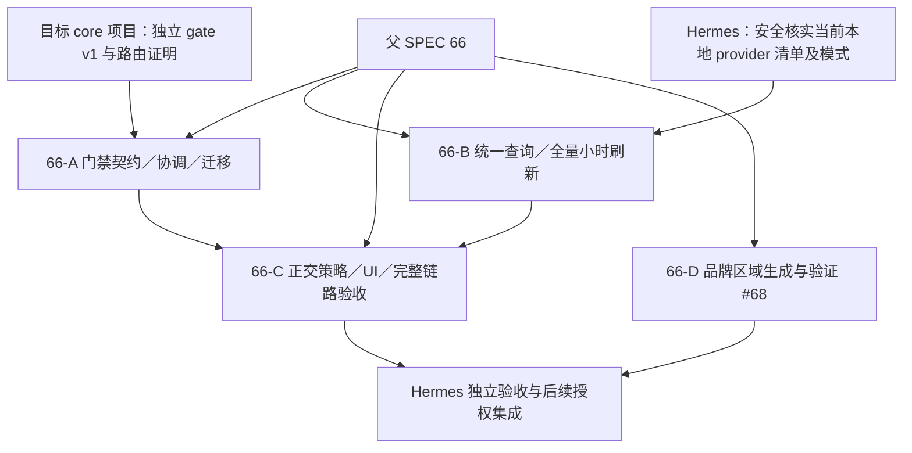

# #66 规划记录、依赖与验收覆盖

日期：2026-10-16。父需求：[#66](https://github.com/williamxhero/CPA-Manager-Plus-ex/issues/66)，原始规格：[统一额度刷新、独立自动暂停与 EX 图形区域定位](../unified-balance-refresh-and-auto-suspension.zh-CN.md)。

**交付状态：PARTIAL（规划产物；不是功能完成）。** 本轮不实现、不访问 live、不部署、不重启、不合并、不关闭 issue。原 SPEC 不变；本目录是实施澄清与子 SPEC 草案，不能替代原验收。仅品牌子 SPEC 成功发布到 GitHub，A／B／C 草案仍待发布，不能称为已登记的 canonical 子 SPEC。用户后续显式加载 `/to-tickets` 后已形成 12 份纵向票，8 张成功发布，4 张仅本地；T08 发布被权限拒绝后停止后续外部写入。实际票号、依赖及门槛见[票据交接](./ticket-handoff.zh-CN.md)。

## 1. 工作流与权限记录

- 工作区 `D:/WILL/AGENT/CPA/cpamp-issue66-plan`，分支 `claude/issue66-plan`，起点 `f3e078e6c0d5d104a33d5577397e5fc49b1570a8`；该目录是既有隔离 worktree，复用本会话和 writer，不因阶段切换另开实现者。
- 已按用户要求读取 scratch 任务说明。祖先 `D:/`、`D:/WILL`、`D:/WILL/AGENT`、`D:/WILL/AGENT/CPA` 与项目根均无 AGENTS.md／CLAUDE.md，项目下也未发现同名指令。遵守已提供的用户全局 CLAUDE.md。
- 已读 CONTRIBUTING、PR 模板、fork maintenance。未发现独立 ADR 或领域 glossary，沿用父 SPEC 的凭证／provider／额度窗口／余额／冷却／ownership 术语。
- 只读调查读取 core 自身 AGENTS.md 和其引用式 CLAUDE.md；没有改 core、配置、凭据或其他项目。两个调查子任务均为只读，结果回到同一 writer，现已结束。
- CodeGraph 在两个调查项目都未初始化；未为规划修改索引，改用只读源码检索。
- 在用户新指示后的安全边界重新读取 `dev-workflow-rules/SKILL.md`，版本 **3.0.0**；继续同 owner／分支，保留既有 SPEC、权限及 Hermes 独立验收。不将历史“本次只发布规格”当成永久开发禁令，但本轮仍严格只规划。
- `/to-spec`：**真实 Skill 调用成功**，按其模板形成 4 个有意义的子 SPEC；测试 seam 采用父 #66 已确认的管理 API＋隔离 core 真实路由，用户授权推荐默认值，不重复访谈。
- `/to-tickets`：初次模型发起的 Skill 调用被拒绝，原文为 `Skill to-tickets cannot be used with Skill tool due to disable-model-invocation`，当时未复刻流程。**后续用户在同一会话显式输入 `/to-tickets`，实际技能正文已加载，阶段调用阻塞解除**；依用户既有推荐默认授权形成 12 张纵向票，不另开 writer。该阶段仅用已公开 #66／#68 需求外发，不发布此前被拦截的跨项目源码调查。
- 票据发布进度：T01–T07、T11 对应 #70／#71／#73／#74／#75／#76／#77／#72；T08 创建被权限层以 external-system-write 拒绝，未改用其他工具重试，T08／T09／T10／T12 仅本地。其他原生关系写入随之停止；仅 #71 blocked_by #70 已成功并回读验证。外部权限拒绝不是临时故障，不自动退避重试。
- GitHub 标签已核实有 `ready-for-agent`，父 #66 为 OPEN。不存在待复用的 #66 子 SPEC。创建 A／B／C 的调用被权限层拒绝；D 成功创建为 [#68](https://github.com/williamxhero/CPA-Manager-Plus-ex/issues/68)。没有重试其他工具绕过拒绝，没有关闭任何 issue。
- A／B 被拒绝原因为跨项目源码调查信息公开的 data-exfiltration 边界；C 被拒绝为 external-write 授权边界，尽管 scratch 任务有允许创建子 SPEC 的文字，仍尊重实际工具拒绝。**包含这些本地草案的提交不得改以 push 绕过同一发布限制。**
- PR 目标核查：CONTRIBUTING 要求到 `williamxhero/CPA-Manager-Plus-ex:dev`。第一次 `git ls-remote --heads fork main dev` 仅返回 main；后续只读复查时 dev 已出现，指向本轮基线 `f3e078e6`，**不是本 worker 创建**。缺 base 阻塞已解除；跨项目信息发布及外部写权限拒绝尚未解除，因此仍未 push／开 PR，不借 main 绕过贡献规则。

## 2. 四个有意义工作包

| 子 SPEC | 交付边界 | GitHub | 当前依赖／阻塞 |
|---|---|---|---|
| [66-A 独立门禁](./core-gate-contract.zh-CN.md) | core 消费契约、ACK／CAS／身份、管理协调、历史迁移／降级 | 发布被拒；本地草案 | core 目标项目实现与验收；不能直接修改另一仓库 |
| [66-B 查询与刷新](./balance-refresh.zh-CN.md) | 安全查询深模块、精确金额、来源身份、全量小时任务及 API | 发布被拒；本地草案 | 当前实例脱敏清单与必要权限；身份契约与 A 协调，只读部分可先行 |
| [66-C 策略与展示](./status-policy-ui.zh-CN.md) | 正交状态、余额策略与全部渲染点、最终本地完整链路 | 发布被拒；本地草案 | 自动动作依赖 A／B；只读 UI 不可冒充 gate 完成 |
| [66-D 品牌](./brand-regions.zh-CN.md) | 图形区域元数据、源生成、全部输出与消费者 | [#68](https://github.com/williamxhero/CPA-Manager-Plus-ex/issues/68) | 独立，无 core／余额依赖 |

推荐四包，而非把父规格的每个小步骤变成新 SPEC：A 是跨项目运行时契约，B 是独立查询／调度域，C 是管理员用户闭环与集成，D 是独立品牌根因；各有自己的需求、测试、发布门槛。保留包内协调，避免新增逐诊断或逐平台 SPEC。**本表不是实施 tickets**；后续显式加载的 `/to-tickets` 另有[12 票与依赖交接](./ticket-handoff.zh-CN.md)。已发布票仍以原父 #66／品牌 #68 为 canonical 需求，不将未发布 A／B／C 冒称 GitHub SPEC。

## 3. 依赖图与 Hermes Kanban 交接

这是依赖提案，不是 Kanban board；worker 未创建卡片、看板或额外 coordinator。达到 ≥3 SPEC 的强制 Kanban 阈值，**Hermes 必须创建并链接 4 个工作包的卡片**；发布未成功的草案先解决 canonical 登记再排实施。各卡 workspace／repo 为本 CPAMP-EX worktree／fork；输入为父 #66 与对应子 SPEC；交付、验收与依赖见上表和各 SPEC。跨项目 core 实现交目标仓库 owner，不把 core writer 放在本项目工作区。

## 4. 已核实源码与能力结论

调查基线 manager `f3e078e6`、core `a4acc9f752bd46571f737a10c04bf413656ab06b`。**不是当前运行实例证明，未运行以下行为测试。** core 路径以 `D:/WILL/AGENT/CPA/CLIProxyAPI-source/` 为根，只读证据在本地保留，受外发限制；不能据本页宣称已部署版本。

### manager 证据

| 事实／缺口 | 可复核源码位置（本仓库） |
|---|---|
| worker 处理 usage 失败／due cooldown，并非全量小时刷新；仍写共享 disabled | `apps/manager-server/internal/worker/rate_limit_auto_disable.go:153-204,373-446,816-847,1784-1785` |
| 恢复已有 identity／owner 与失败保持停用守卫，可复用但非新 gate | 同文件 `698-813,853-874`；`quota_recovery_probe.go:73-154` |
| 手动变更清 inspection ownership，不能假定已清 cooldown ownership | `apps/manager-server/internal/service/proxy/service.go:216-300,437-446` |
| snapshots 是窗口浮点域、被动存取，不是钱包金额／全量刷新 | `apps/manager-server/internal/service/quotasnapshot/service.go:31-49,67-117`；`internal/model/account_quota_snapshot.go:3-41` |
| policy 启动先应用 persisted 配置，OFF 不自动恢复，可保留 | `apps/manager-server/internal/worker/automation_runtime.go:61-79,99-115` |
| provider row 无余额域；手动用排除所有模型或 disabled | `apps/web/src/components/providers/ProviderTable/rowData.ts:19-72,119-189`；`features/aiProviders/AiProvidersPage.tsx:408-479` |
| provider render key 有 Key／名称／位置回退，不能作持久 ID | `apps/web/src/components/providers/utils.ts:264-293` |
| 浏览器刷新目标为选中／当前页；不是服务端来源 single-flight | `apps/web/src/features/accounts/AccountsPage.tsx:6550-6599`；`utils/quota/providerRefreshScheduler.ts:25-42,70-103` |
| 前端有 generation guard，但 Qwen 失败清 payload，需统一旧值保留 | `apps/web/src/components/quota/quotaRefresh.ts:53-66,81-132`；`quotaConfigs.ts:116-143,930-946` |
| 既有 secret protector／configured 模式可复用；client 不能当余额 SSRF 边界 | `apps/manager-server/internal/security/security.go:128-159`；`internal/service/managerconfig/service.go:309-342`；`internal/service/cpa/client.go:26-35,134-145` |

### core 证据（仅本地调查，不向独立项目写入）

| 事实／风险 | core 相对路径及行号 |
|---|---|
| Auth 无独立 owner／evidence gate；禁用 handler 是人工状态／配置排除 | `sdk/cliproxy/auth/types.go:47-108`；`internal/api/handlers/management/auth_files_fields.go:28-68,97-146` |
| v8 无所需门禁管理族；v0 禁止新增功能 | `internal/api/server_management_v8.go:30-62`；`AGENTS.md:63` |
| selector／scheduler 不含独立 gate；存在 legacy/plugin 和快路径 | `sdk/cliproxy/auth/selector.go:823-906`；`scheduler.go:849-880`；`conductor_selection.go:1983-2241` |
| 同 Auth 401 刷新后直接重试；只改 selector 会漏 | `sdk/cliproxy/auth/conductor_execution.go:595-612` |
| WS pin／下一轮、Alpha Search、Codex Live 有额外准入点 | `sdk/api/handlers/openai/openai_responses_websocket_session.go:134-145,208-236`；`internal/api/server_routes.go:370-380,438-476`；`internal/client/codex/live/live.go:493-499` |
| 模型注册表 suspension 不等于 ClientSupportsModel 路由硬门禁 | `internal/registry/model_registry.go:1154-1229`；`sdk/cliproxy/auth/conductor_selection.go:999-1011` |
| cooldown 到期／reset／普通成功可放行，不能代表证据驱动恢复 | `sdk/cliproxy/auth/selector.go:885-906`；`conductor_cooldown.go:493-520,800-820` |
| 配置合成身份／关闭行省略不满足持久 incarnation 与行成员版本 | `internal/watcher/synthesizer/config.go:289-401`；`helpers.go:15-51`；`sdk/cliproxy/auth/types.go:327-431` |
| Generation 重启归一，普通持久化失败仍可发布成功，不能复用为 gate ACK | `sdk/cliproxy/auth/conductor_lifecycle.go:280-323,430-442,486-509` |
| Home 有外部调度／retained WS，不可宣称 standalone 修改即覆盖 | `sdk/cliproxy/auth/conductor_home.go:548-589,951-975,1027-1040` |
| 管理查询可绕推理路由，但通用 api-call 不满足余额 SSRF／响应限制 | `internal/api/handlers/management/api_tools.go:135-238,818-833`；`plugin_quota.go:266-297` |

**结论：真实 core 依赖成立。** 不采用 disabled／模型排除伪装。目标项目需交付 v8 capability v1、稳定实例／资源／身份／成员版本、owner+CAS+operation ACK、每次推理尝试准入与启动前恢复。金额与自动策略在 CPAMP，不将钱包逻辑塞进 core。

## 5. UI 全部渲染点与品牌生成源清单

以下路径以 `apps/web/src/` 为根。状态组件复用同一后端状态，不能每页另建策略。

| 渲染点 | 位置 | 验收要求 |
|---|---|---|
| 凭证网格／列表 | `features/accounts/AccountsPage.tsx:9017-9083,9514-9555` | 名称前标志，复制与人工开关独立 |
| 凭证详情 header | 同文件 `10006-10039` | 与列表一致，不伪造实时路由资格 |
| 凭证全局策略 | `features/accounts/components/CredentialAutoStartStopToggle.tsx:12-59` | 保留 OFF／locked／error，不作行状态 |
| provider 表格／窄屏卡片 | `components/providers/ProviderTable/ProviderTable.tsx:191-245`；同目录 `.module.scss:4-5,56-71` | 余额列、名称标志、人工控件均保留 |
| provider 详情 | `components/providers/ProviderDetailDrawer/ProviderDetailDrawer.tsx:318-345` | 余额范围与 footer 人工状态正交 |
| provider 健康组 | `components/providers/ProviderHealthCheckDrawer/ProviderHealthCheckDrawer.tsx:278-311` | 人工开启不表示清自动暂停 |
| 巡检结果／监控概览 | `features/monitoring/components/CodexInspectionResultsPanel.tsx:278-307`；`AccountOverviewCard.tsx:98-153` | 不把 enabled／旧证据冒充当前有效状态 |
| 动作候选历史 | `features/monitoring/AccountActionCandidatesPage.tsx:303-331` | 明确历史／当前语义，不增 policy owner |
| 创建／导入／旧 edit route | `features/planCredentials/PlanCredentialsPage.tsx:145-170`；`features/oauth/OAuthPage.tsx:1385-1405`；`router/MainRoutes.tsx:129-171` | 无观测显示未知，索引不是持久身份 |
| splash／登录 | `components/common/SplashScreen.tsx:30-42`；`features/login/LoginPage.tsx:572-603` | 竖横图文 EX 不遮字 |
| 侧栏 symbol／wordmark | `components/layout/MainLayout.tsx:942-964` | 不重复 DOM EX，不覆盖纯文字 |

品牌生成源：`bin/branding/generate-cpamp-ex-assets.py:73-76,117-163,194-202,300-339`。当前整图锚点与无差别 wordmark 加标为根因。源 ref `419c65fc`，覆盖 15 SVG＋15 PNG、ICO 每帧、touch、server copies 和三处 index fallback。现有 `tests/cpampExBranding.test.mjs:135-203,217-293` 中 blanket EX／DOM tag 断言与新要求冲突，实施时应替换被改写的行为断言，保留有效副本／像素／完整性检查，不删测试逃避回归。

## 6. 父规格 18 项验收覆盖矩阵

编号引用原 SPEC 的 Testing Decisions，不重写或削弱原用例。

| 原验收编号 | 负责 SPEC | 必须保留的外部行为证据 |
|---|---|---|
| 1 | A＋C | A/B 真实路由，新的请求／重试／故障转移排除自动暂停资源 |
| 2 | A＋B＋C | 暂停中查询可达，可信恢复后重新准入 |
| 3 | A＋C | 手动关不被自动恢复覆盖，旧 API 回归 |
| 4–5 | B＋C | 精确 ≤0.1／>0.1，同证据幂等，多轮低正数不振荡 |
| 6 | B＋C | 所有错误／未知／陈旧均非零且不误恢复，旧成功值保留 |
| 7 | B | 当前清单协议权限、字段、符号、单位及脱敏 fixture |
| 8 | B＋C | 共享不重复、独立／跨币种／部分未知不误停整行 |
| 9–10 | B | 浏览器关闭全量小时刷新，补刷／租约／公平／single-flight／429 |
| 11 | A＋B＋C | 换 Key／账户、重排、重建、实例切换、迟到与 CAS 隔离 |
| 12 | A＋C | capability／应用／启动恢复故障可观察，不谎报保护 |
| 13 | A＋B＋C | 历史 ownership／人工意图安全迁移与降级回退 |
| 14 | C | 上述全部渲染点、明暗／窄屏／键盘／触屏 |
| 15 | D | 几何＋实际渲染、全资产／fallback／无双角标 |
| 16 | A＋B＋C | secret canary、管理鉴权、SSRF／DNS／redirect／代理禁止断言 |
| 17–18 | B＋C，Hermes 独立验收 | 当前本地运行实例逐 provider 真实查询／金额／小时／gate 证据，不用历史配置或 fixture 代替 |

测试主 seam 沿用已确认的管理 API＋隔离真实 core；补协议与 UI／资产行为测试。现有管理 HTTP 集成测试、quota probe、ownership fail-closed、快照幂等、前端 late-response／provider 行操作映射均可复用，不能当成新 gate 已验证。

## 7. 默认选择及理由

1. 四包按运行时契约／查询调度／用户闭环／品牌分域；不照父规格六条建议机械创建六个 SPEC。
2. 不再询问已确认测试 seam；只 mock 外部平台和时钟，不 mock 被验收状态机和实际 selector。
3. 金额十进制字符串＋精确比较，单位原生、保留欠款，禁止 float／显示舍入／汇率参与规则。
4. 60 分钟、并发 4、15 秒默认／60 秒硬预算、2 MiB 沿用父 SPEC；稳定错峰／失败 next due，避免洪泛。
5. 来源 single-flight 与确认账户范围绑定，不按 host 合并不同钱包；CAS／incarnation／source version 防止串号与迟到覆盖。
6. provider 首次策略 OFF 后明确启用；旧凭证策略／锁／OFF 不恢复语义不变。不能由启用 provider 顺带改凭证策略。
7. core 独立持久 gate，不回退 disabled；standalone 可为首版能力起点，但实际当前模式不能被排除，Home 若需要仍是必交阻塞。
8. manifest 明确图形／文字保护区，纯 wordmark 不加覆盖标，全部输出同源生成；不用临时登录页盖层。
9. 未提供安全可得的 live 认证通道，**未寻找或读取凭据，未访问 8317**；清单核实交 Hermes。这里的“本地 CPA”仅沿用 #66 对本期运行范围的特殊明确约定，不连接 yosef-server、不处理小电脑 Qwen。

## 8. 实际验证、剩余门槛与下一步

本轮只读核实源码和项目约束、形成规划并发布部分 SPEC／tickets。没有运行业务单元／集成测试、类型、构建、live 服务网络、品牌生成器或 UI；没有实现可供这些行为测试验收。初轮临时文档校验：5 份 Markdown、12 个本地相对链接、各 SPEC 必需章节／Use Case／父 issue／部署门槛及示例秘密前缀检查通过，初轮 `git diff --cached --check` 通过。后续 12 份票据的模板、父链接、验收及简单秘密前缀校验通过；已只读回查 8 张发布票，正文与本地一致，全部 OPEN、仅 `ready-for-agent`；各自 native blockers 与交接记录一致，父 #66／#68 均仍 OPEN。原始父 SPEC 无改动。完整后续验证与实际提交见[票据交接](./ticket-handoff.zh-CN.md)及交付报告；临时检查脚本不入库。

建议后续实施验证命令（**不是本轮已通过记录**）：`npm run manager-server:test`、后端 race、`npm run test:web`、`npm run test:repo`、`npm run type-check`、`npm run lint`、`npm run build`、`npm run check:web-icons`、`python bin/branding/generate-cpamp-ex-assets.py --check`；核心新增真实路由套件由目标项目按其 AGENTS 执行。icon check 需要已构建 bundle，generator check 需要 Pillow 与干净源 ref。

剩余动作／权限边界：

- `/to-tickets` 显式调用已完成，不再要求重调；待解决 T08 对本 fork 的外部写权限后，在同 owner／worktree 发布剩余四票，换回实际编号并补齐原生 blockers。当前不得称票据发布／关系登记全部完成。
- 解决 A／B／C 发布权限，复核允许外发范围后建立 canonical GitHub 子 SPEC；不在 worker 中修改安全设置、不以 push 绕过拒绝。
- Hermes 按四包依赖图建立 Kanban 并链接 SPEC；当前未创建 board／卡片。
- Hermes 获取脱敏当前 provider／模式清单与最低必要查询权限；未解决项保持具体交付阻塞。
- 按 cross-project-delegation 交目标 core owner 实现并取回 capability／revision／路由证明；本项目只消费契约。
- 合规 PR base `dev` 在后续复查已出现；解决外发限制后复核其 head，再 push 本分支、开规划 PR。不得为满足“有 PR”将被拒公开的草案改由 Git push 发布。
- 后续实现沿用本 owner，完成自测后交 Hermes 独立验收；精确 head CI、完整回归、迁移／回退、授权发布和实际部署表面检查均保留。不合并、不关闭问题、不声称落地。
