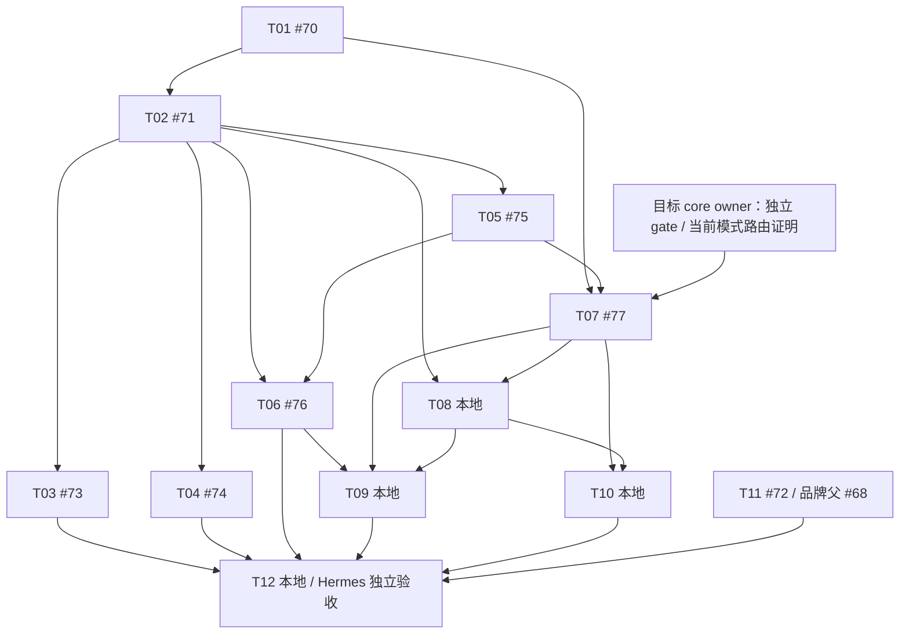

# #66 纵向票据交接

日期：2026-10-16；分支 `claude/issue66-plan`；工作区 `D:/WILL/AGENT/CPA/cpamp-issue66-plan`。**PARTIAL：规划交付，不是实施完成。** 复用既有 writer；用户显式加载 `/to-tickets`，按已授权推荐默认值形成以下 12 个切片。四包 SPEC 与源码调查仍见[本地规划记录](./planning.zh-CN.md)，原父需求及全部验收不变。

## 1. 实际票号、正文与阻塞

下表箭头含义为「本票须等待」。GitHub 链接只表示真实已创建的 issue，不预测未发布票号。

| 票 | 本地正文 | GitHub 状态 | 完整计划 blockers |
|---|---|---|---|
| T01 稳定身份／能力可见 | [正文](./tickets/01-resource-capabilities.md) | [#70](https://github.com/williamxhero/CPA-Manager-Plus-ex/issues/70) OPEN | 无 |
| T02 首个安全余额来源 | [正文](./tickets/02-first-balance-source.md) | [#71](https://github.com/williamxhero/CPA-Manager-Plus-ex/issues/71) OPEN | #70 |
| T03 当前官方协议 | [正文](./tickets/03-current-official-adapters.md) | [#73](https://github.com/williamxhero/CPA-Manager-Plus-ex/issues/73) OPEN | #71 |
| T04 当前兼容／授权会话 | [正文](./tickets/04-current-compatible-adapters.md) | [#74](https://github.com/williamxhero/CPA-Manager-Plus-ex/issues/74) OPEN | #71 |
| T05 凭证统一查询 | [正文](./tickets/05-credential-quota-query.md) | [#75](https://github.com/williamxhero/CPA-Manager-Plus-ex/issues/75) OPEN | #71 |
| T06 全量小时任务 | [正文](./tickets/06-hourly-refresh.md) | [#76](https://github.com/williamxhero/CPA-Manager-Plus-ex/issues/76) OPEN | #71、#75 |
| T07 凭证独立暂停 | [正文](./tickets/07-credential-gate.md) | [#77](https://github.com/williamxhero/CPA-Manager-Plus-ex/issues/77) OPEN | #70、#75；外部 core gate 契约／证明 |
| T08 provider 金额策略 | [正文](./tickets/08-provider-policy.md) | 发布被拒，仅本地 | #71、#77；外部 provider gate 能力 |
| T09 迁移／重启／回退 | [正文](./tickets/09-migration-reconciliation.md) | 未发布，仅本地 | #76、#77、T08 |
| T10 全渲染点一致性 | [正文](./tickets/10-all-status-surfaces.md) | 未发布，仅本地 | #77、T08 |
| T11 图形区域品牌闭环 | [正文](./tickets/11-brand-regions.md) | [#72](https://github.com/williamxhero/CPA-Manager-Plus-ex/issues/72) OPEN | 无；直接父 #68 |
| T12 完整链路／独立验收交接 | [正文](./tickets/12-independent-acceptance.md) | 未发布，仅本地 | #73、#74、#76、T09、T10、#72；当前清单／安全授权／Hermes 验收 |

切片决策：先以身份读取和一个余额来源实现 demoable 路径，再补当前清单协议、额度查询、调度与自动门禁；历史安全与全表面一致性各有独立可验收结果，品牌并行。不是按 schema／API／UI 横向拆票。当前清单未知时不虚构平台数量；若必要协议／连接器超单上下文范围，在原父 SPEC 下创建明确范围跟进票并保留最终阻塞，不无限扩张一个 ticket。

## 2. 原生关系的真实完成度

已执行并回读：**#71 blocked_by #70**。

仅正文已记录、原生关系尚待登记：#73←#71、#74←#71、#75←#71、#76←#71/#75、#77←#70/#75。其余未发布票须在权限解除、取得真实 issue 编号并替换 T 引用后再登记。本地完整图不是原生关系全部建立的证明。

这是依赖图提案，不是看板。四包达到强制 Kanban 阈值，**由 Hermes 创建并链接卡片**；本 worker 没有创建 board／卡片。理论无 blocker 的实施起点为 T01／T11，但本轮没有启动任何实施。

## 3. 权限、发布与持久化边界

- 票据外发内容仅依据已公开父 #66／#68，不含独立 core 源码、私有调查细节或运行秘密。A／B／C 子 SPEC 仍仅本地，未通过 ticket 发布绕过其公开限制。
- T08 对 `williamxhero/CPA-Manager-Plus-ex` 的 `gh issue create` 被权限层拒绝，原因为 external-system-write，要求用户显式授权该 issue／目的地。未尝试替代工具／API 或修改安全设置；随即停止剩余发布、关系写入等外部变更。
- 未发布票保存本地以便恢复，不宣称 canonical GitHub 登记完成。父 #66／#68 未在 ticket 阶段修改／关闭；没有创建 native subissue 关系去修改父问题。
- 初轮本地提交 `6ebc6997b26255e7238881619fd9fa93db9e86de` 包含被拒公开的调查文档；**禁止把本分支整体 push 当作发布绕行**。本轮仅本地提交票据与状态。无 push、PR、merge、deploy 或服务重启。PR base 规则仍为 fork 的 `dev`。
- Hermes 需解决合法公开范围与外部写权限，保留当前会话／工作树；恢复时先读目标 issue 与 git 状态，避免重复创建。不要对拒绝自动退避重试。

## 4. 实际检查与未通过门槛

- 12 份 ticket 的模板、父链接、验收／Hermes 门槛、简单秘密前缀检查通过；本目录 18 份 Markdown 的 28 个相对链接与 fence 检查通过；`git diff --cached --check` 通过。仅 14 份规划文档新增／更新，父 SPEC 和业务代码未改。这只是文档校验，不是应用安全证明。
- 只读回查 #70–#77：8 张正文与本地一致，均 OPEN，仅有 `ready-for-agent`，无 `needs-template`；已核查各自 native blockers，只有 #71←#70 存在。#66／#68 仍 OPEN、`ready-for-agent`。
- 未运行任何业务／core 路由测试、真实余额查询、前端渲染、generator、build 或 CI；没有实现可供验收。临时检查脚本在 job tmp，不加入仓库。
- 当前实例 provider／凭证／模式清单与安全认证留 Hermes；不得读取或导出真实 Key／Cookie，不连接 yosef-server，不处理小电脑 Qwen。
- 后续依次完成剩余票发布与关系、A／B／C canonical 登记／Hermes Kanban、目标 core owner 契约实现、全部切片自测与精确 head CI、Hermes 独立验收；生产备份／迁移／回退及显式部署授权始终保留。任何票 ready-for-agent 均不授权本规划轮实施。
